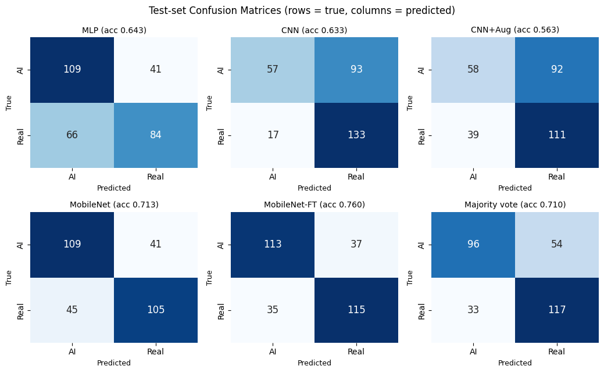
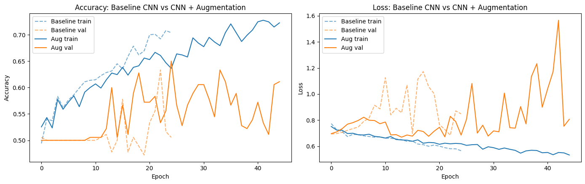
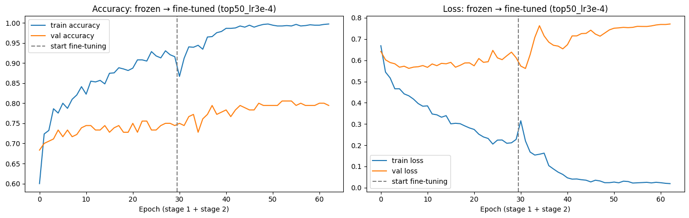

# Real vs. AI-Generated Face Detection

Detecting AI-generated faces from a small dataset by comparing five deep learning approaches, from a simple MLP to a fine-tuned **MobileNetV3**, with a 12-run fine-tuning study, a **BatchNorm ablation**, and an interactive **"Human vs. Model" Gradio game**.

**Best result: 76.0% test accuracy** (fine-tuned MobileNetV3Small) on a fixed, balanced test set of 300 images, up from 63% for a CNN trained from scratch.

🎥 **Demo:** [`assets/demo.mp4`](assets/demo.mp4) · [watch on Google Drive](https://drive.google.com/file/d/14T3czH1rFwQnU1gRjW6p7-fXYCjTK5Sx/view?usp=sharing)
📓 **Notebook:** [`real_vs_ai_face_detection.ipynb`](real_vs_ai_face_detection.ipynb)

---

## The problem

- **Task:** binary classification. Is a face real or AI-generated?
- **Data:** 1,020 training / 180 validation / 300 test images (128×128 RGB, balanced classes).
- **Why it's hard:** the difference lives in subtle texture artifacts rather than obvious shapes, and the dataset is tiny.

## Approach

```
MLP / CNN baselines → CNN + data augmentation → frozen MobileNetV3 (head search)
→ fine-tuning grid + BatchNorm ablation → model comparison → Gradio game
```

| Stage | What I did | Why |
|---|---|---|
| Augmentation | Keras augmentation layers: flip, ±11° rotation, 5% shift, 10% zoom | Only subtle geometric changes; blur, noise or colour jitter could erase the generation artifacts |
| Model selection | Checkpoints selected by **validation accuracy**, with a warm-up before early stopping | Validation loss selected a chance-level model (see findings) |
| Transfer learning | MobileNetV3Small (ImageNet), frozen, global average pooling, three classifier heads compared | Reuse features learned from 1.4M images |
| Preprocessing | Inputs rescaled to [0, 255] | Keras MobileNetV3 includes its own rescaling layer; feeding [0, 1] silently degrades results |
| Fine-tuning | Two-stage training; coarse-to-fine grid over unfreeze depth (15–100%) × learning rate (1e-5 to 1e-3); BatchNorm kept frozen | Adapt features without destroying them |
| Evaluation | Metrics recomputed from saved models; confusion matrices; per-class recall; error analysis | Accuracy alone hides what kind of mistakes a model makes |

## Results

| Model | Parameters | Test accuracy | AI faces caught | % predicted "Real" |
|---|---|---|---|---|
| MLP | 6.3M | 64.3% | 73% | 42% |
| CNN (from scratch) | 31k | 63.3% | 38% | 75% |
| CNN + augmentation | 31k | 56.3% | 39% | 68% |
| MobileNetV3 (frozen) | 1.0M | 71.3% | 73% | 49% |
| **MobileNetV3 (fine-tuned)** | 1.0M | **76.0%** | **75%** | **51%** |



## Key findings

**1. Checkpointing on validation loss picked a model that was guessing.**
The first augmented CNN restored epoch 3, with 49.7% test accuracy. Its validation loss was **0.693 = −ln(0.5)**, the loss of predicting 0.5 for every image: uncertain predictions never make *confident* mistakes, so they score well on cross-entropy. Selecting by validation accuracy fixed it.

**2. Augmentation delayed overfitting but didn't improve accuracy.**
Validation loss stayed flat for ~15–20 more epochs, but test accuracy varied between runs (it improved in one, dropped in another). Likely causes: resampling blur, reflect padding creating textures absent from real photos, and a small CNN underfitting the harder task.



**3. Frozen features hit a ceiling at ~75% validation accuracy**, whatever the classifier head (linear 71.1%, two larger heads tied at 75.6%), so the features themselves were the bottleneck.

**4. Fine-tuning: learning rate mattered most, and BatchNorm can break everything.**

| Finding | Evidence |
|---|---|
| 1e-5 changed nothing | every 1e-5 run ended at the same 76.1% validation accuracy after epoch 1 |
| 1e-4 to 3e-4 worked best | 77.8% → 80.6% validation accuracy (50% of layers unfrozen) |
| Gains plateau around 30–50% unfrozen | 76.7 / 77.2 / 77.8 / 77.2 / 77.8% for 15 / 30 / 50 / 70 / 100% |
| **BatchNorm ablation** | same layers and learning rate: BatchNorm trainable **66.7%** vs frozen **78.9%** |
| Mechanism | BatchNorm moving variances changed by ~3.5 on average while the learnable gamma/beta barely moved: statistics drift from small batches |



**5. Accuracy hid important behaviour.**
The CNN reached 63% accuracy but caught only **38%** of AI faces, because it labelled three quarters of all faces "Real". A majority vote of all five models (71.0%) did *worse* than the best single model, because the two CNNs share the same bias and outvote it. Twelve test images fooled every model, and the fine-tuned model was confidently wrong on them.

**Honest caveats:** with 300 test images, accuracy has a standard error of about ±2.5%, and the best model was selected from 12 runs, so its validation score is somewhat optimistic. A realistic estimate of the fine-tuning gain is +1 to +5 points.

## Interactive demo

A 10-round Gradio game where the player and the model classify the same face, with live scores, the model's confidence after each guess, and a final winner. Test images were exported as lossless PNGs so the app sees exactly the same pixels as the notebook (it reproduces the notebook's 76.0% test accuracy).

```bash
cd app
pip install -r requirements.txt
python app.py          # then open http://localhost:7860
```

The app needs `best_model.keras` and a `test_images/` folder next to `app.py`; both are generated by Part 8 of the notebook.

## Repository structure

```
├── real_vs_ai_face_detection.ipynb   # full pipeline with outputs
├── app/
│   ├── app.py                        # Gradio game
│   └── requirements.txt
├── assets/                           # figures and demo video
└── requirements.txt
```

## Running the notebook

The face dataset is not redistributed in this repository. Set `FILE_ID` in Part 0 to the Google Drive ID of a copy of the dataset zip, or point the paths to a local copy. A GPU runtime (e.g. Colab T4) is recommended for Parts 5–6.

## Tech stack

Python · TensorFlow / Keras · MobileNetV3Small · scikit-learn · NumPy · Matplotlib / Seaborn · Gradio · Google Colab

## What I'd try next

- Repeat key configurations over several random seeds (or k-fold) to measure run-to-run variance properly.
- Higher input resolution, since 128×128 may discard high-frequency generation artifacts.
- Frequency-domain features, since AI-generated images often leave traces in Fourier space.
